<h1 align="center">Bookworm - NLP Book Cards Engine</h1>

<p align="center">
  <a href="https://github.com/hugoegry"></a>
  &nbsp;
  <a href="mailto:hugo.egry@epitech.eu"></a>
  &nbsp;
  <a href="https://github.com/hugoegry?tab=stars"></a>
</p>
<p align="center">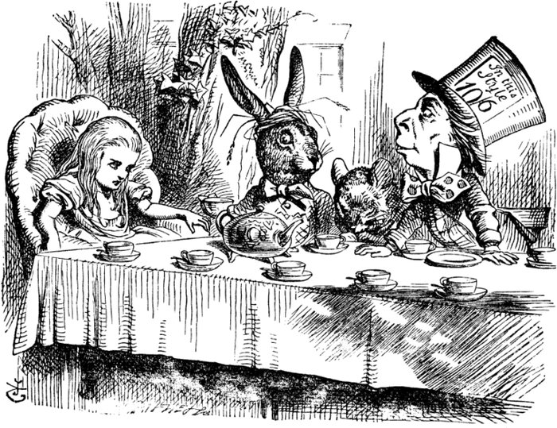</p>

<h2 align="center">A <strong>lightweight NLP engine</strong> that turns raw Project Gutenberg books into structured <strong>book cards</strong>: lexical diversity, topics, entities, summary and similar books.</h2>
<br>

<div align="center">

<p align="center">
  
  
  
  
  
  
  
</p>

[NLP tasks](#nlp-tasks-methods-and-choices) • [Installation](#running-it) • [Structure](#project-structure) • [Team](#contributors) • [License](#license)

</div>
<br>

---

## About The Project

<div align="center">

| **School Project** | **Epitech - T-AIA-600** | **2025-2026** |

</div>

### Project Context

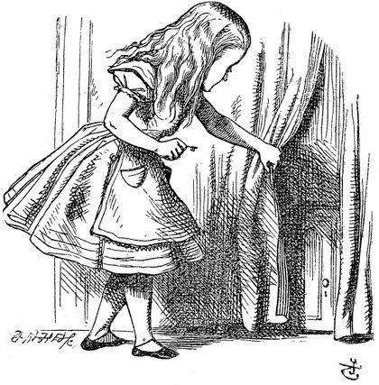

This project is part of our curriculum at **Epitech** (Montpellier). The assignment was to build a prototype **NLP engine** for *Through the Looking-Glass*, a fictional startup that creates **book cards** so publishers and editors can understand books from [Project Gutenberg](https://www.gutenberg.org/) without reading them entirely.

The program, `bookworm.py`, exposes one CLI command per task (`--lexdiv`, `--topic`, `--entities`, `--summarize`, `--similar`, `--card`). The brief asked us to compare several methods for each task, justify our choices, draw one diagram per pipeline, cache expensive results and avoid heavy models (no LLMs or large transformers).

| Requirement | Where |
|---|---|
| Lexical diversity, topics, entities, summary, similarity, book card | `nlp_pipeline/nlp/` |
| Method comparison | notebooks in `tests/` |
| One diagram per pipeline | `shéma/` (shown below) |
| Cache of expensive results | `nlp_pipeline/storage/cache.py` |
| Clear error messages | `nlp_pipeline/errors.py` |

---

## Architecture

Every task reuses the same shared bricks: Gutendex metadata → Gutenberg text download → boilerplate removal → disk cache → shared preprocessing (tokens, sentences, chapters, stop words).

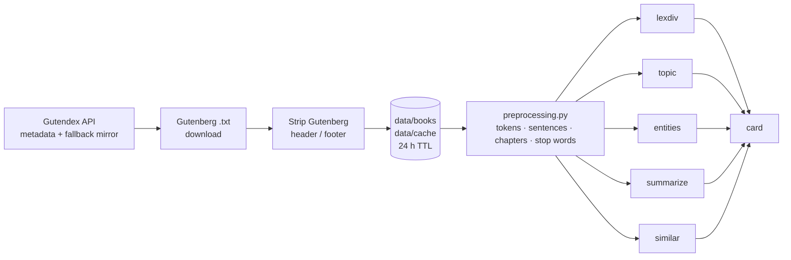

<p align="center">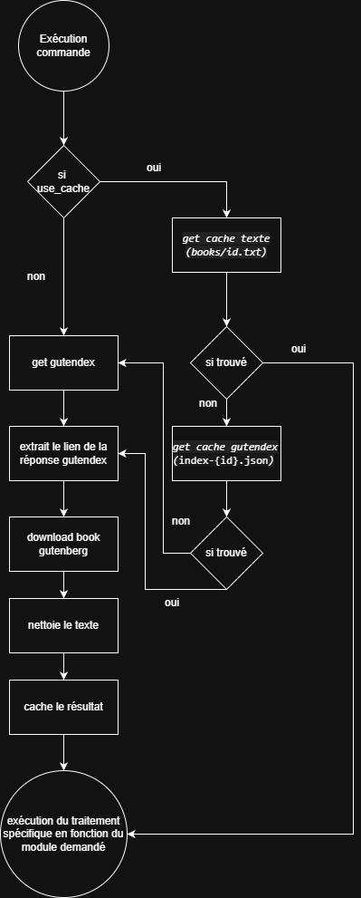</p>

---

## NLP tasks, methods and choices

For each task we compared several approaches in Jupyter notebooks (`tests/*.ipynb`) before picking a default.

### Lexical diversity — `--lexdiv`

Words are extracted with a regex (`\b[a-z]{3,}\b` on lower-cased text), then counted:

| Metric | Formula |
|---|---|
| `tok` | number of word tokens |
| `typ` | number of distinct tokens |
| `hap` | tokens occurring exactly once (hapax legomena) |
| `ttr` | `typ / tok` |
| `mwl` | mean characters per token |
| `mwf` | `tok / typ` |

<p align="center">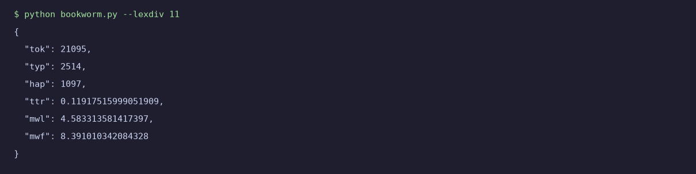</p>

Run on the whole 21-book collection:

<p align="center">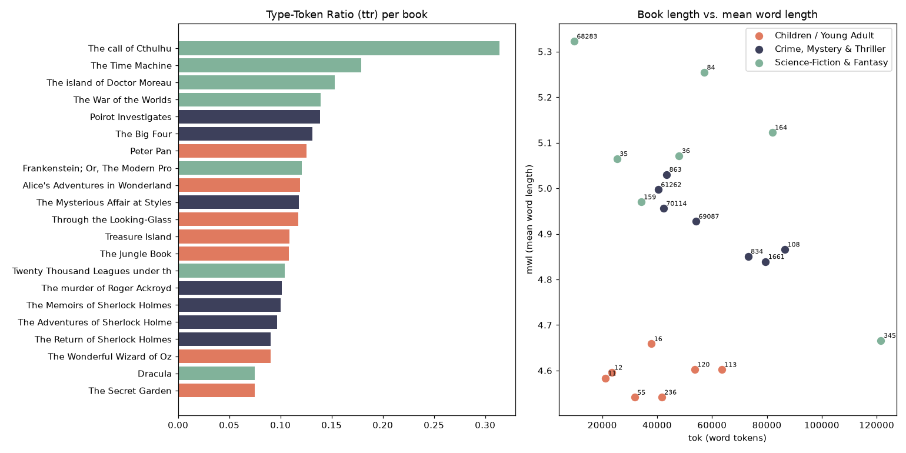</p>

- **Why**: simple, deterministic, explainable counts, exactly what the brief asks for.
- **Limitations**: the regex keeps only words of **3+ letters** (so *a, I, of, to…* are not counted), which lowers `tok` and raises `mwl`; `ttr` depends strongly on book length (the short *Call of Cthulhu* gets the highest TTR, 0.31), which is why length-robust measures (MATTR, MTLD…) would be a good next step.

<p align="center">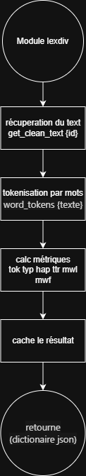</p>

### Topic modeling — `--topic`

The book is split into chapters (regex on `CHAPTER I`, `PART ONE`, roman-numeral headings, with a fallback into ~12 equal sections), stop words are removed, then each chapter is a document of a **TF-IDF** matrix; the 10 highest-scoring words of each chapter form its topic.

- **Default**: our own TF-IDF implementation (`TFIDF_METHODE = "perso"`), with scikit-learn's `TfidfVectorizer` as an alternative.
- **Alternative compared**: plain **Bag-of-Words** frequencies (`topic_bow.py`), simpler but dominated by words frequent everywhere; TF-IDF favours words that are distinctive for a chapter.
- **Limitations**: dialogue verbs such as *said* still appear in many chapters; no LDA/LSA (latent topics), which would be the next step.

Real output for *Alice's Adventures in Wonderland* (12 chapters detected):

<p align="center">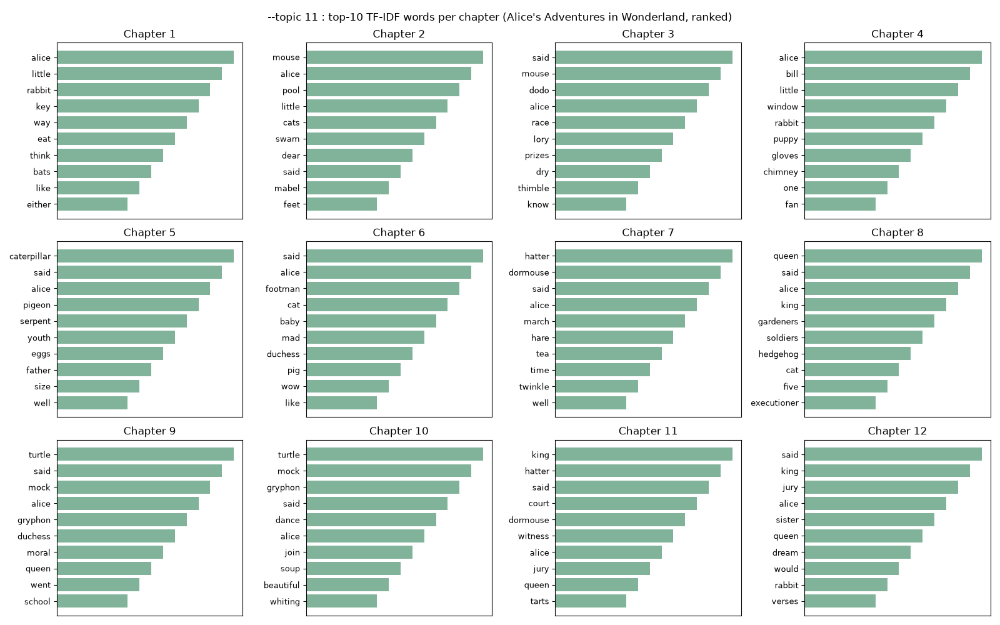</p>

You can follow the story: the pool of tears and the Mouse (ch. 2), the Caucus-race with the Dodo (ch. 3), the Caterpillar (ch. 5), the mad tea-party with the Hatter, Dormouse and March Hare (ch. 7), the Queen's croquet (ch. 8), the Mock Turtle and Gryphon (ch. 9–10), the trial (ch. 11–12).

<p align="center">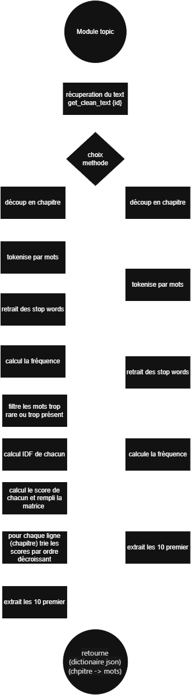</p>

### Named entity recognition — `--entities`

Four extractors are implemented and share the same **voting and filtering logic** (`entities/common.py`):

| Extractor | File | Idea |
|---|---|---|
| spaCy `en_core_web_sm` (**default**) | `spacy.py` | small statistical NER model, text processed in 200 000-character chunks |
| spaCy `en_core_web_md` | `spacy_md.py` | medium model, better vectors, slower |
| NLTK `ne_chunk` | `nltk.py` | classic POS tagging + chunking |
| Custom regex | `personalise.py` | patterns such as *"said Alice"*, *"in Wonderland"*, possessives, capitalised n-grams |

Each candidate collects `PERSON` vs `GPE/LOC/FAC` votes; it is kept if it has enough mentions, is capitalised in most occurrences (≥ 60 %), passes a POS check, and one label wins by a 1.5× ratio. Results are capped at 25 and sub-names are merged.

<p align="center">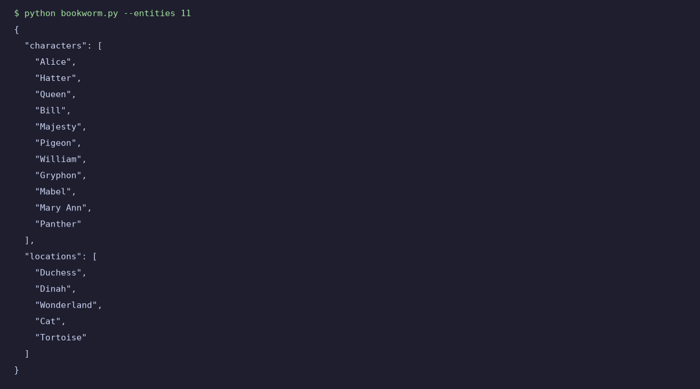</p>

- **Why**: small models are fast, run on CPU and stay within the "no heavy models" rule; voting removes much of the noise of a single pass.
- **Limitations** (visible above): animal or title characters are sometimes mis-labelled as locations (*Duchess*, *Cat*, *Dinah*), and *Majesty* is a title, not a name. Fictional texts are hard for models trained on news.

<p align="center">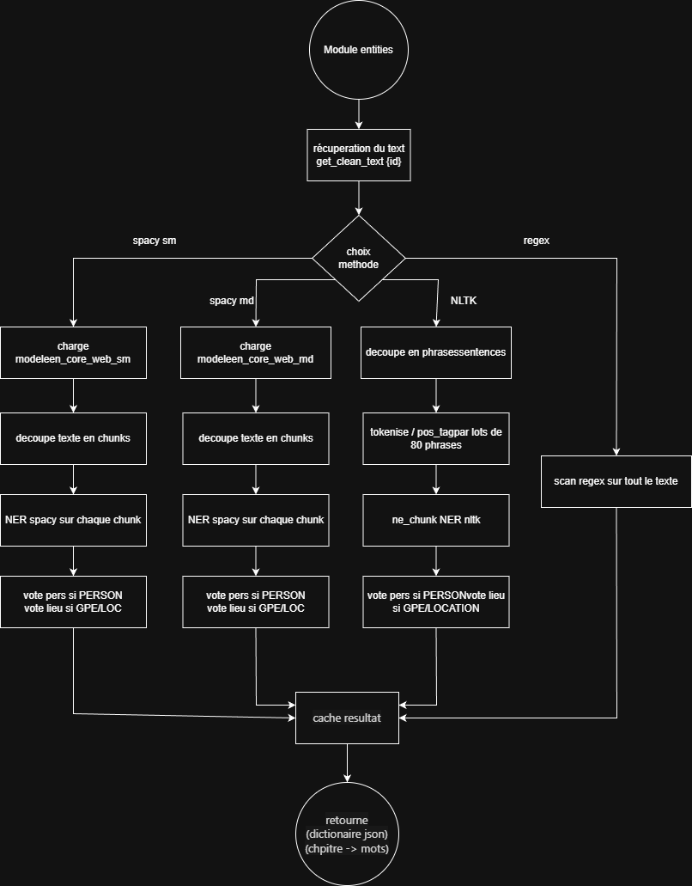</p>

### Summarization — `--summarize`

**Extractive, two-level TextRank**:
1. split the book into chapters;
2. in each chapter, build a TF-IDF sentence graph (cosine similarity, edges < 0.1 dropped), run **PageRank** (NetworkX) and keep the best sentence (score = 0.7 × PageRank + 0.3 × position);
3. run the same ranking on the chapter sentences and keep the **5** best, in reading order.

<p align="center">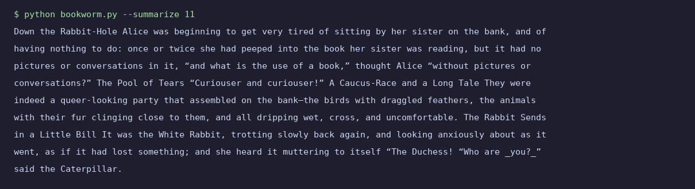</p>

- **Why extractive?** No training, no GPU, no heavy model: it fits the constraints and every sentence comes from the book, so nothing is made up.
- **Alternatives considered**: abstractive summarization (transformers such as BART/T5, excluded as too heavy), clustering-based extraction.
- **Limitations**: chapter titles can stick to the first sentence (*"Down the Rabbit-Hole Alice was…"*), the result reads as a collage rather than a narrative, and a long book takes a few dozen seconds (~27 s for Alice on our test machine).

<p align="center">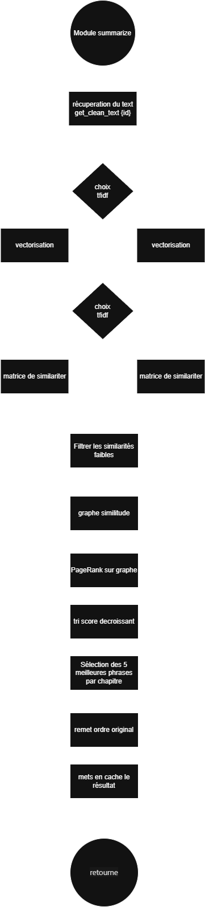</p>

### Book similarity — `--similar`

Each of the 21 books of the brief's collection is turned into a vector, and the reference book is compared with all the others by **cosine similarity** (our own implementation or scikit-learn's).

| Method | File | Book vector |
|---|---|---|
| **Word2Vec** (**default**) | `similarity/word2vec.py` | Gensim Word2Vec trained on the 21 books (100 dims, window 5, 10 epochs, seed 42), book = mean of its word vectors |
| TF-IDF | `similarity/tfidf.py` | sparse TF-IDF vector of the whole book |
| SBERT | `similarity/sbert.py` | `all-MiniLM-L6-v2` sentence embeddings (200 sentences) averaged |

Book vectors are cached in `data/cache/embed-<method>-<id>.json`.

<p align="center">
  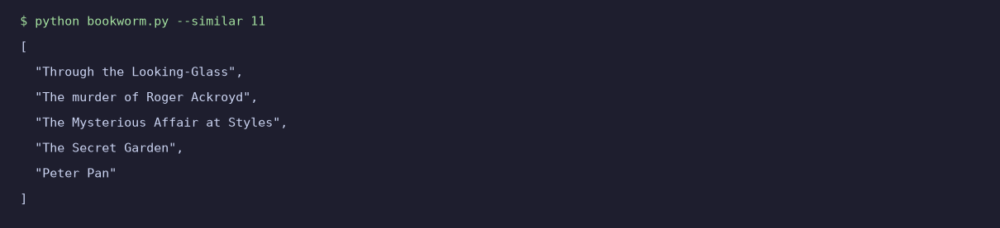
  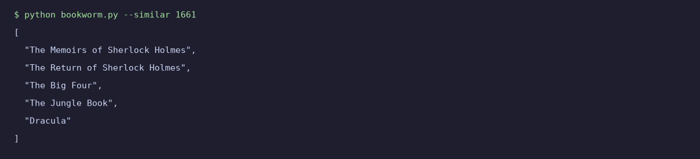
</p>

The Sherlock Holmes stories find each other, and *Alice* finds *Through the Looking-Glass* first. The full Word2Vec cosine matrix shows the three genre blocks of the collection:

<p align="center">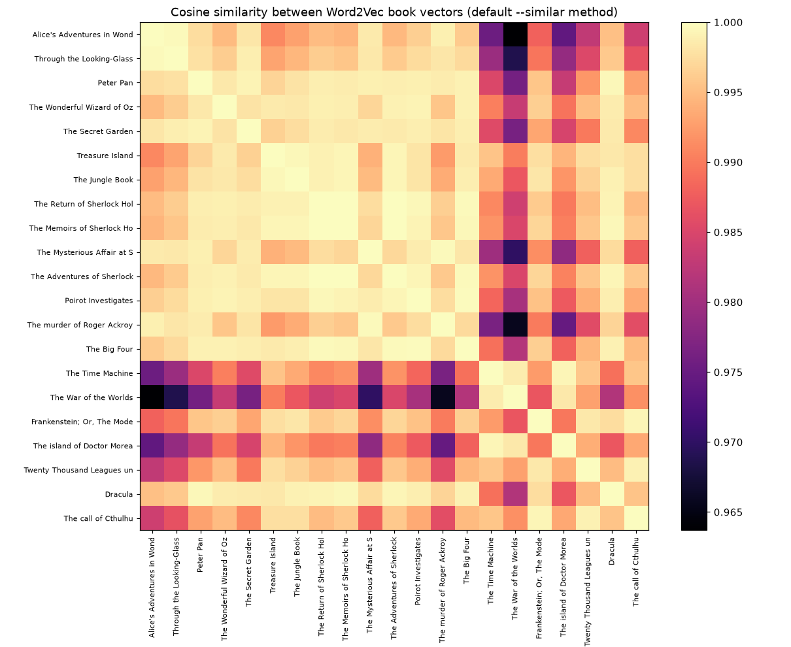</p>

- **Limitations**: averaging word vectors squeezes all scores into a narrow band (0.96–1.0), so ranks 3–5 can mix genres (e.g. two Agatha Christie novels in Alice's top 5).

<p align="center">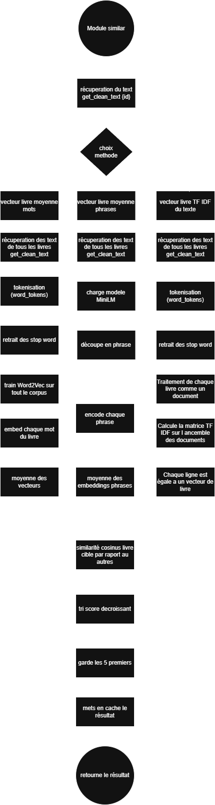</p>

### Book card — `--card`

`card.py` calls every task and gathers the results with the Gutendex metadata:

```json
{
  "info": { "id": 11, "title": "Alice's Adventures in Wonderland", "authors": [...], "bookshelves": [...], ... },
  "lexical_diversity": { "tok": 21095, "typ": 2514, "hap": 1097, "ttr": 0.119, "mwl": 4.58, "mwf": 8.39 },
  "topics": { "1": ["alice", "little", "rabbit", ...], ..., "12": [...] },
  "entities": { "characters": ["Alice", "Hatter", "Queen", ...], "locations": ["Wonderland", ...] },
  "summary": "…",
  "similarity": ["Through the Looking-Glass", "The murder of Roger Ackroyd", "The Mysterious Affair at Styles", "The Secret Garden", "Peter Pan"]
}
```
*(real values from `python bookworm.py --card 11`, truncated)*

---

## Caching and error handling

| What | Where |
|---|---|
| Cleaned book texts | `data/books/<id>.txt` |
| Gutendex metadata | `data/cache/index-<id>.json` |
| Entities, similarity results, book vectors | `data/cache/<task>-<id>.json` |

Cache entries expire after 24 h; `--no-cache` bypasses them and `--clear-cache all|data|output` empties them. Gutendex has a fallback mirror. Errors are typed (`errors.py`) and shown as short coded messages instead of tracebacks (set `DEBUG_MODE = True` in `config.py` to see them):

<p align="center">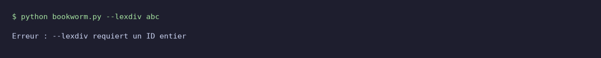</p>

---

## Project structure

```
├── bookworm.py              CLI entry point
├── requirements.txt
├── nlp_pipeline/
│   ├── cli.py               argument parsing and dispatch
│   ├── config.py            parameters + the 21-book collection
│   ├── preprocessing.py     cleaning, tokens, sentences, chapters, stop words
│   ├── errors.py            typed errors with codes
│   ├── retrieval/           Gutendex + Gutenberg clients
│   ├── storage/cache.py     JSON / text cache with TTL
│   └── nlp/                 lexdiv, topic/, entities/, summarize, similarity/, card, tfidf, cosine_sim
├── tests/                   notebooks comparing methods
├── shéma/                   one draw.io diagram (+ PNG) per pipeline
└── data/{books,cache,output}  generated at runtime (not versioned)
```

## Running it

```bash
python -m venv .venv
source .venv/bin/activate          # Windows: .venv\Scripts\activate
pip install -r requirements.txt
python -m spacy download en_core_web_sm
python -m nltk.downloader punkt punkt_tab stopwords averaged_perceptron_tagger_eng maxent_ne_chunker_tab words
```

<p align="center">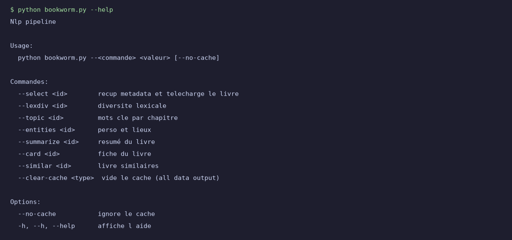</p>

```bash
python bookworm.py --select 11       # download metadata + text
python bookworm.py --lexdiv 11
python bookworm.py --topic 11
python bookworm.py --entities 11
python bookworm.py --summarize 11
python bookworm.py --similar 11      # downloads the 21 books on first run
python bookworm.py --card 11
python bookworm.py --clear-cache all
```

---

## Contributors

<div align="center">
<table>
  <tr><th>Avatar</th><th>Name</th><th>Role</th><th>GitHub</th></tr>
  <tr><td align="center"></td><td><b>Hugo Egry</b></td><td>Team lead · CLI, retrieval &amp; cache, NER</td><td><a href="https://github.com/hugoegry">@hugoegry</a></td></tr>
  <tr><td align="center"></td><td><b>Loic Noro</b></td><td>Topics, preprocessing &amp; similarity</td><td><a href="https://github.com/LoicEpitech">@LoicEpitech</a></td></tr>
  <tr><td align="center"></td><td><b>Rewann Tannou</b></td><td>Lexical diversity, summary &amp; book card</td><td><a href="https://github.com/RewannTannou">@RewannTannou</a></td></tr>
</table>

<sub>Epitech Montpellier · T-AIA-600 · 2025-2026</sub>
</div>

---

## License

This project is released under the [MIT License](LICENSE).

Copyright (c) 2025-2026 **Hugo Egry**, **Loic Noro**, **Rewann Tannou**.